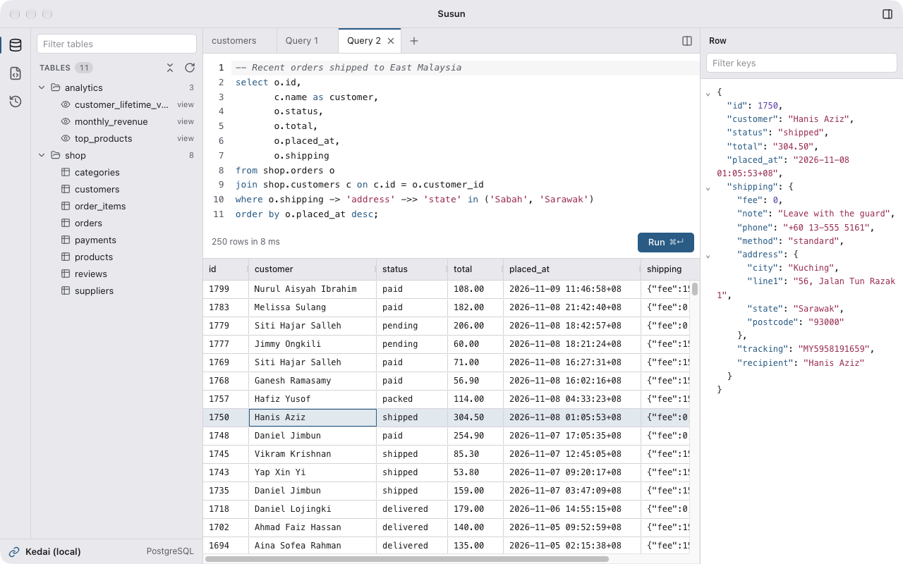
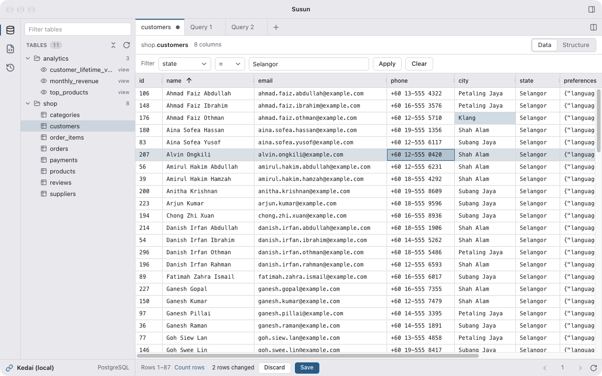
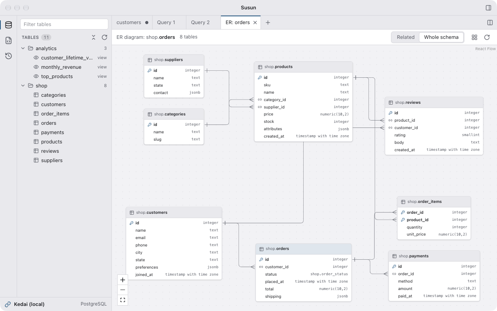
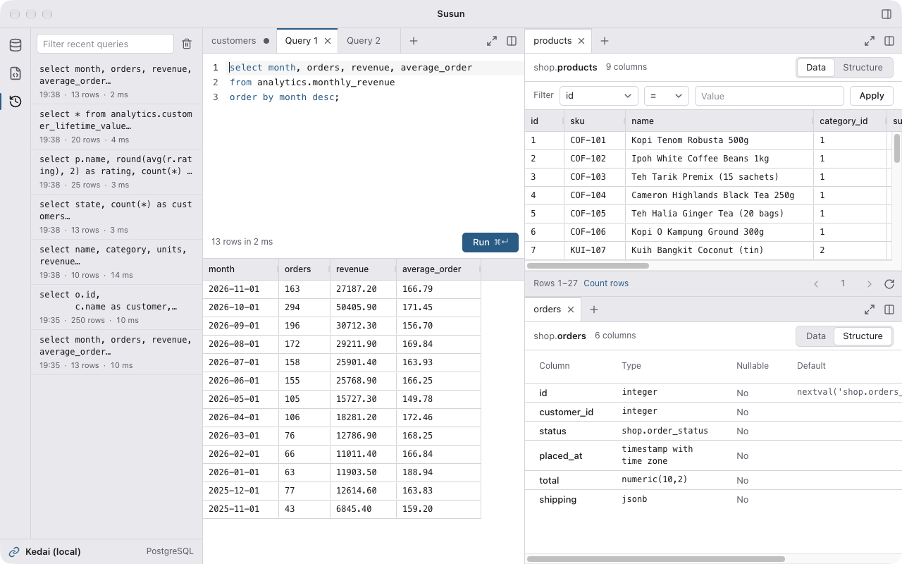
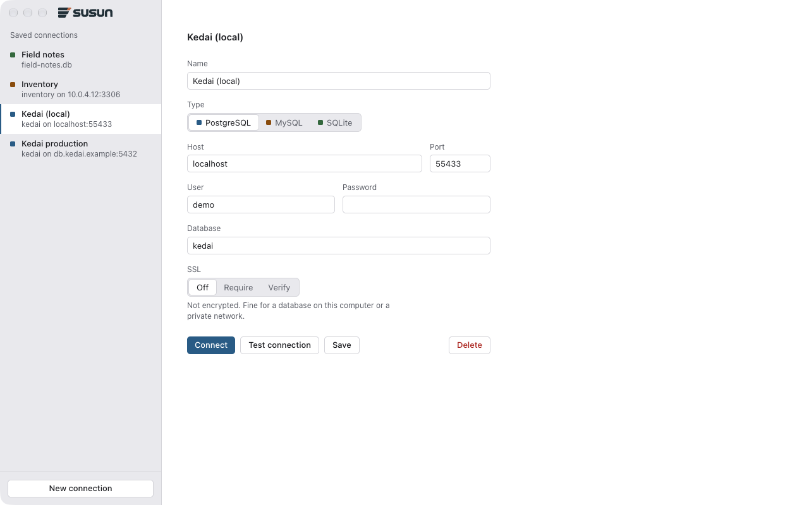

<p align="center">
  
</p>

<p align="center">
  A desktop database client for PostgreSQL, MySQL and SQLite.<br>
  SQL editor, table browser, JSON row viewer, ER diagrams and split panes, in one window.
</p>

<picture>
  <source media="(prefers-color-scheme: dark)" srcset="docs/images/query-dark.png">
  
</picture>

## What "susun" means

_Susun_ (say _soo-soon_) is Malay for "to arrange" or "to stack": to put things in order, one on top
of another. You _menyusun_ books on a shelf, a _susunan_ is an arrangement, and _susun atur_ is a
layout. It's what the app does with your data, rows stacked in a grid and tabs arranged into panes,
and it's what the logo draws: three rows stacked in order, the top one tipped with copper.

## Features

### SQL editor

- Syntax highlighting and keyword completion in each database's own dialect.
- **⌘Enter** runs the selection, or the whole script. Susun splits a script into statements the way
  psql, the mysql client and sqlite3 do (quotes, comments, Postgres dollar quotes, MySQL
  `DELIMITER`, trigger and routine bodies), runs them one at a time with a result for each, and
  stops at the first error.
- Each query tab has its own database session, so tabs run side by side, and a transaction, temp
  tables and settings stay in the tab that made them. **Cancel** stops only that tab's query.
- Values arrive exactly as stored: 64-bit integers aren't rounded, and dates and times appear as the
  database formats them, microseconds included, without time-zone shifts.
- Results show up to 10,000 rows, and say so when a query returned more.
- Open and save `.sql` files (**⌘O**, **⌘S**). Susun asks before closing unsaved work.
- **Saved queries** lists the `.sql` files you've saved or opened while connected to a database, and
  **Recent queries** keeps its last 1,000 runs.

### Table browser

<picture>
  <source media="(prefers-color-scheme: dark)" srcset="docs/images/table-dark.png">
  
</picture>

- Double-click a table to browse it 100 rows at a time. Sorting and filtering run in the database,
  so they cover the whole table, not just the page on screen.
- Tables with a primary key can be edited in place. Changed cells stay highlighted until you
  **Save**, which applies every change in one transaction, or **Discard**.
- The **Structure** view lists the columns with their types, nullability and defaults.
- Right-click a table to view its data or structure, open its ER diagram, copy its name, start a
  `SELECT`, or truncate or drop it (after asking).

### Row panel

The selected row of whichever grid you're in, as read-only JSON, with folding and a filter by key.
A Postgres JSON column shows up nested, like the order's shipping address in the screenshot at the
top. It works for query results and table rows alike, and shows a table row's unsaved changes.

### ER diagrams

<picture>
  <source media="(prefers-color-scheme: dark)" srcset="docs/images/diagram-dark.png">
  
</picture>

Choose **ER Diagram** from a table's right-click menu to see that table and every table its foreign
keys link it to, or switch to **Whole schema**. Lines end in a crow's foot at the table holding the
key. Tables can be dragged around, and the layout, pan and zoom stay with the tab.

### Panes and tabs

<picture>
  <source media="(prefers-color-scheme: dark)" srcset="docs/images/panes-dark.png">
  
</picture>

- Split the tab area like VS Code's editor groups: **⌘\\** splits the current tab to the side, or
  drag a tab onto another tab bar, or onto the edge of a pane to split it.
- Maximize a pane, jump between panes with **⌘1** to **⌘9**, and close a tab's neighbours from its
  right-click menu.
- Rearranging panes never reloads them: an editor keeps its undo history and a grid its scroll
  position.

### Connections

<picture>
  <source media="(prefers-color-scheme: dark)" srcset="docs/images/connect-dark.png">
  
</picture>

- PostgreSQL, MySQL (and MariaDB) and SQLite.
- TLS: off, require (encrypted), or verify (also checks the certificate and host name against the
  system's trusted certificates).
- Saved connections keep their passwords encrypted with the system keychain.
- Switch to a recent connection from the bar at the bottom of the sidebar.
- If the server drops the connection, Susun reconnects the next time you run something. It never
  sends a statement twice, and if the lost session held state, such as an open transaction, it
  tells you before running anything else.
- Each window (**⌘N**) has its own connection, tabs and panes.

Light and dark themes follow the system, and each database type has its own accent colour.

### Keyboard shortcuts

| Shortcut                  | Action                            |
| ------------------------- | --------------------------------- |
| **⌘Enter**                | Run the selection, or the script  |
| **⌘T**                    | New query                         |
| **⌘O** / **⌘S** / **⇧⌘S** | Open, save, save as a `.sql` file |
| **⌘W**                    | Close tab                         |
| **⌘\\**                   | Split the current tab to the side |
| **⌘1** to **⌘9**          | Go to pane 1 to 9                 |
| **⌘N** / **⇧⌘W**          | New window, close window          |
| **⌘,**                    | Settings                          |

On Windows and Linux, use **Ctrl** in place of **⌘**.

## Status

Susun is in active development, and installers aren't published yet: for now, build it from
source. It's developed on macOS; Windows and Linux builds are set up with electron-builder. No
license has been chosen yet.

## Development

You'll need Node 24 and pnpm 11.

```bash
pnpm install       # also downloads Electron and rebuilds the native modules for it
pnpm dev           # run the app with hot reload
pnpm test          # unit tests (Vitest)
pnpm lint          # ESLint
pnpm typecheck     # TypeScript, main and renderer
pnpm build         # typecheck, then build into out/
pnpm build:mac     # package with electron-builder into dist/ (also build:win, build:linux)
pnpm icons         # remake the app icons from the logo (needs rsvg-convert)
```

Susun is built with Electron, React, TypeScript and Vite (electron-vite). The database drivers
(`pg`, `mysql2`, `better-sqlite3`) run in the main process, and the page reaches them only through a
small typed API. [`CLAUDE.md`](CLAUDE.md) describes the architecture in detail, and
[`PLAN.md`](PLAN.md) tracks what's done and what's next.

The screenshots use _kedai_ (Malay for "shop"), a made-up online shop selling kopi, kuih, batik and
crafts. Every name and contact detail in it is invented.
